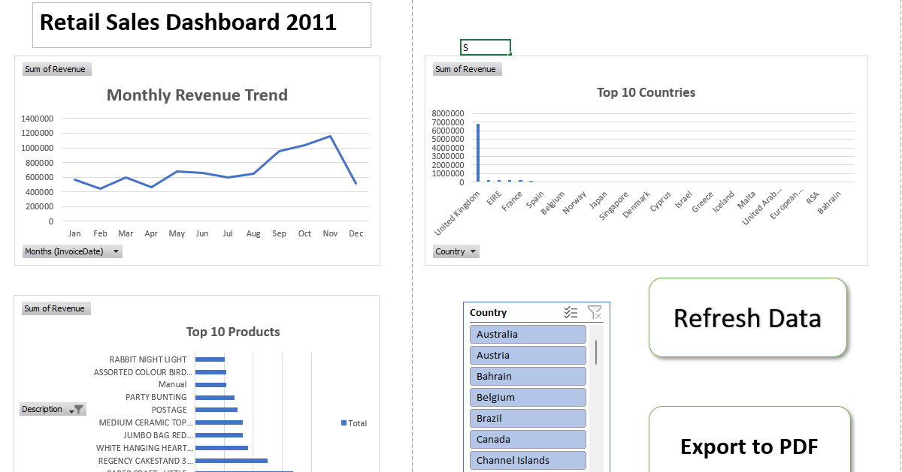

# Automated Retail Sales Reporting System

An Excel-based reporting project that automates retail data cleaning, analysis, dashboard creation, and PDF report generation using Power Query and VBA.

## Business Problem

Combining monthly sales files and updating reports manually is time-consuming and prone to errors.

## Solution
- **Power Query:** Combines and transforms monthly sales files.
- **Excel:** Uses PivotTables, charts, and slicers to analyze sales trends, top products, and country-wise revenue.
- **VBA:** Automates data refresh and PDF report export.
- **Data Quality:** Handles missing customer IDs, returns, and cancellations according to defined cleaning rules.

## Tech Stack
Excel · Power Query · VBA · PivotTables · Charts

## How to Use
1. Open `Retail_Sales_Dashboard.xlsm` in desktop Excel and enable macros if prompted.
2. Ensure the monthly data files are in the `Monthly_Sales` folder.
3. Click **Refresh Data** to update the report.
4. Click **Export to PDF** to generate the dashboard report.

## Data Source & Attribution
Dataset: [Online Retail — UCI Machine Learning Repository](https://archive.ics.uci.edu/dataset/352/online+retail)

Citation: Chen, D. (2015). *Online Retail* [Dataset]. UCI Machine Learning Repository. https://doi.org/10.24432/C5BW33

License: [CC BY 4.0](https://creativecommons.org/licenses/by/4.0/)

The original dataset was split into simulated monthly files. Data cleaning, transformations, and dashboard development were performed for this project.
